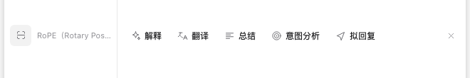
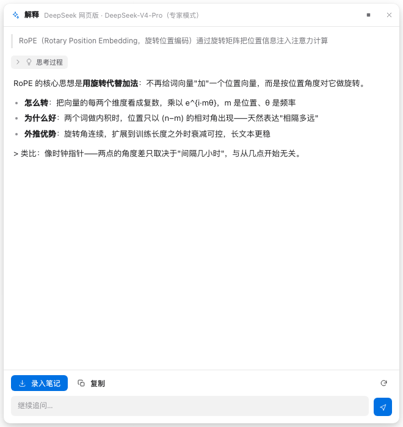
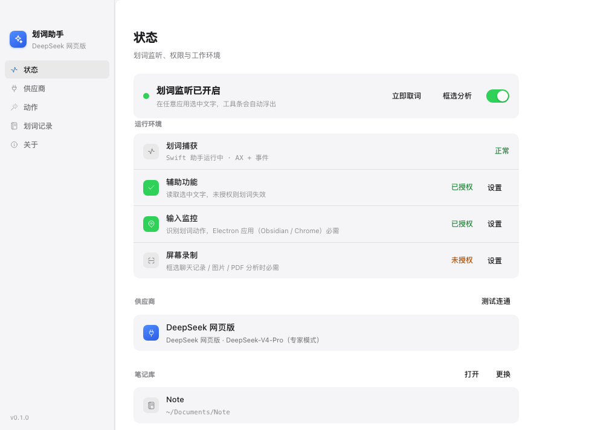
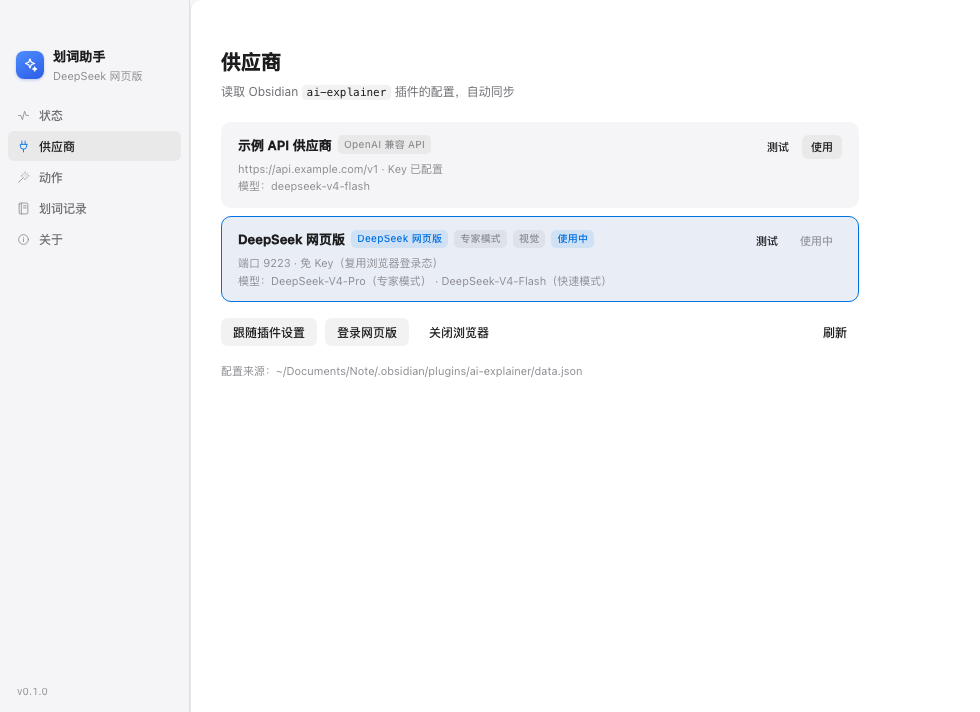
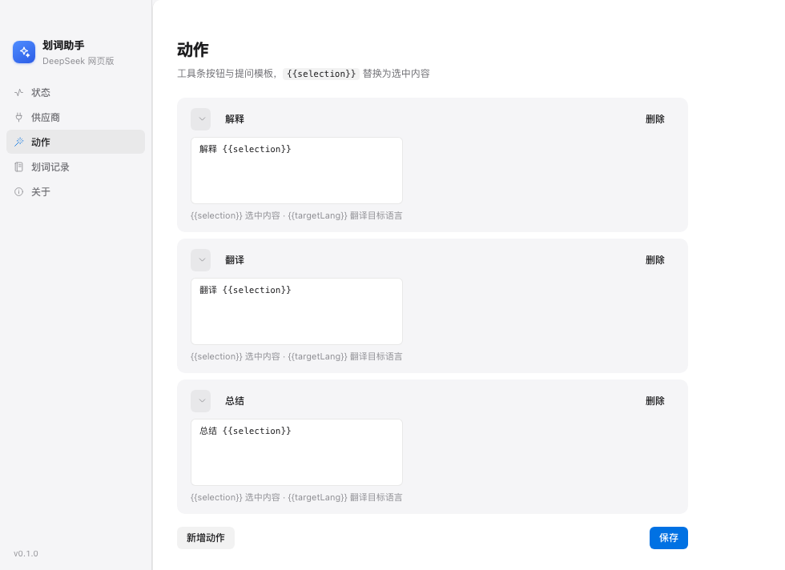
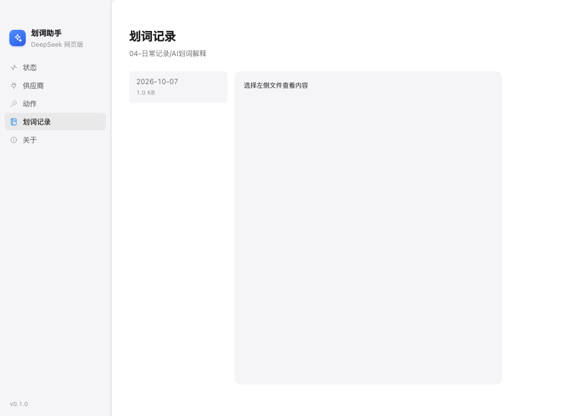

# 划词助手（macOS 桌面版）

> 系统级「豆包式」划词助手：在**任何应用**里选中文字 → 浮出工具条 → AI 流式解释 → 一键录入 Obsidian 笔记。
> **API / Key 与你的 Obsidian `ai-explainer` 插件完全共用**，无需重复配置。

```
选中文字 ──▶ 浮动工具条 ✨解释 🌐翻译 📝总结 ──▶ 结果卡片（流式/追问） ──▶ 📥 录入笔记
```

### 效果截图

划词后浮出的工具条（截图右上角为手动关闭 ✕）：



流式解释卡片（思考过程可折叠、底部可直接追问、一键录入笔记）：



主窗口（状态 / 供应商 / 动作 / 划词记录 / 关于）：

| 状态 | 供应商 |
|---|---|
|  |  |
|  |  |

> 截图为 UI 示意（示例数据），实际内容取决于你的配置。

---

## 与 obsidian-ai-explainer 插件的关系

| | obsidian-ai-explainer（插件） | 划词助手（本工具） |
|---|---|---|
| 作用范围 | 仅 Obsidian 内部 | **macOS 全系统**（浏览器/PDF/微信/终端…） |
| 配置来源 | 自己维护 `.obsidian/plugins/ai-explainer/data.json` | **直接读取上面这份配置** |
| 供应商 | 三方中转 / 官方 API / DeepSeek 网页版 | 完全相同（含免 Key 的网页版） |
| 结果落地 | 原地插入批注 | 写入独立收集目录 |

> 在 Obsidian 里改了供应商 / Key / 模型，**本工具无需重启即可生效**（每次请求前重读配置）。

---

## 功能

- **划词即用**：鼠标拖拽选取、`Cmd+A` 全选、`Shift+方向键` 扩展选择，都会浮出工具条（不抢焦点，原应用照常操作）
- **工具条跟随选区**：工具条浮出的前提是存在选中文本——点击别处、切换应用、取消选择后自动收起；结果卡片是主动点开的工作面板，阅读/追问/录入期间保持打开，点 ✕ 才收起
- **五种动作**：解释 / 翻译 / 总结 / **意图分析** / **拟回复**，提示词可随意改，也能新增自定义动作
- **框选分析（聊天/图片/PDF）**：按下 `Cmd+Shift+S` 拖拽框选任意屏幕区域 → 本地 OCR 识别文字 → 分析。**微信、钉钉等不暴露系统接口的聊天工具也能用**
- **流式输出 + 思考过程**：推理型模型的 `reasoning_content` 折叠展示，正文边生成边渲染
- **追问**：结果卡片底部可直接追问，多轮对话保持上下文
- **一键录入笔记**：写入 `<vault>/04-日常记录/AI划词解释/YYYY-MM-DD.md`，格式与插件 callout 一致；同一段文字重复解释会**覆盖同条目**而不是堆重复
- **多供应商**：三方 OpenAI 兼容 API（aitry / 智谱 / DeepSeek 官方…）+ DeepSeek 网页版（免 Key，复用插件已登录的专用浏览器）
- **托盘常驻，不打扰**：启动不弹主窗口，后台通过菜单栏图标操作（开/关划词监听、立即取词、框选分析、打开收集目录、打开主窗口）；仅「辅助功能」未授权时静默弹一次引导页

### 为什么需要「框选分析」

微信这类应用用自研 UI 框架绘制界面，**不通过 macOS 的无障碍接口暴露消息内容**（实测：整棵 AX 树只有登录页文字）。所以读取聊天记录采用：

```
框选屏幕区域 → macOS Vision 本地 OCR（中文准确率实测可用，~300ms） → 发给 LLM 分析
```

OCR 在本地完成，**截图不上传**，只有识别出的文字会发给你的 LLM 供应商。
提示词里已注明"OCR 可能有识别误差，请结合上下文推断"，因此个别错字不影响分析质量。

---

## 安装

### 方式一：DMG（推荐）

1. 构建：`bash scripts/build-macos.sh` → 产物 `dist/HuaCiAssistant-<版本>-arm64.dmg`
2. 双击 DMG，把「划词助手」拖进「应用程序」
3. **首次打开**若被 Gatekeeper 拦截：右键 .app → 打开，或到 `系统设置 › 隐私与安全性` 点「仍要打开」
4. 首次运行按引导授予 **辅助功能** 与 **输入监控**；需要框选分析再额外授予 **屏幕录制**

### 方式二：源码运行

```bash
npm install --registry=https://registry.npmmirror.com --electron-mirror=https://npmmirror.com/mirrors/electron/
bash scripts/build-macos.sh --no-dmg   # 编译 Swift helper + esbuild
npm start                              # 启动
```

---

## 权限说明

| 权限 | 用途 | 不授予的后果 |
|---|---|---|
| **辅助功能**（必需） | 读取选中文字（AX API） | 划词完全失效 |
| **输入监控**（强烈建议） | 全局鼠标/键盘事件监听，用于识别「划词动作」并触发 Cmd+C 兜底 | **Electron/Chromium 类应用（Obsidian、VS Code、Chrome）完全无法取词**；原生应用仍可用，但延迟约 0.4s |
| **屏幕录制**（框选分析必需） | 截取屏幕区域做 OCR | 框选分析不可用；纯划词功能不受影响 |

> 授予路径：`系统设置 › 隐私与安全性` 下的「辅助功能」「输入监控」「屏幕录制」三处，都勾选「划词助手」。
> **权限授予后需重启 app 才生效。** 状态页会实时显示三项权限的授权情况，未授权时点「设置」可直接跳转。
>
> 为什么 Electron 类应用必须靠「输入监控」：Chromium 系应用不通过系统 AX 接口暴露选区，
> 只能在你完成划词动作后模拟一次 `Cmd+C` 把文字取出来（读完立即还原剪贴板）。
> 识别"什么时候发生了划词"依赖全局鼠标事件监听，这正是「输入监控」权限提供的。

---

## 使用

### 划词

1. 在任意应用里选中文字（拖拽 / 双击 / `Cmd+A` / `Shift+方向键`）
2. 选区旁浮出工具条 → 点「解释 / 翻译 / 总结」
3. 卡片流式显示答案；底部可「录入笔记」「复制」「重试」，输入框可继续追问
4. 工具条跟随选区：点别处 / 切换应用自动收起；点「解释」等动作后卡片打开，卡片不随点击别处消失，点 ✕ 主动收起

### 框选分析（聊天记录 / 图片 / PDF）

1. 按 `Cmd+Shift+S`（或点托盘菜单「框选屏幕区域分析」，或状态页「框选分析」按钮）
2. 屏幕变暗 → **拖拽框选**要分析的区域（聊天消息、图片里的文字、PDF 内容都行）
3. 松手后自动 OCR，识别完弹出工具条（选区位置显示识别到的文字）
4. 点「意图分析」拆解对方目的与决策依据，或点「拟回复」生成回复草稿

> 视觉上：分析卡片会**紧贴选区下方**浮出，看起来就像挂在聊天气泡下面（无法真正插入微信界面，
> 因为那需要修改微信进程；覆盖层是唯一合规稳定的方式）。

### 快捷键

| 快捷键 | 作用 |
|---|---|
| `Cmd+Shift+E` | 立即取词（默认，可在设置里改/清空） |
| `Cmd+Shift+S` | 框选屏幕区域分析（默认，可在设置里改/清空） |
| `Cmd+S` | 卡片内：录入笔记 |
| `Esc` | 收起工具条 / 卡片（主动关闭） |

### 笔记格式

写入 `04-日常记录/AI划词解释/2026-10-07.md`（按日期每天一个文件，追加）：

```markdown
---
type: ai-capture
created: 2026-10-07
---

# AI 划词记录 2026-10-07

<!-- aif3hkqz -->
> [!note]- ✨ 解释：未来关于IT行业从业人员来说，掌握基础的知识只是该行
> 这段话像承上启下的结论：IT 行业门槛变了——基础知识只让你"能进场"…
>
> **术语**：
> - **IT 行业**：做软件、系统、网络等技术工作的领域。
> <sub>来源：Obsidian · DeepSeek 网页版 DeepSeek-V4-Pro（专家模式）</sub>
```

> 同一段选区再次解释 → 通过 `djb2` 哈希（与插件同算法）定位并覆盖同一条目。
> `PreviousArticle` / `NextArticle` 由你的 series-nav 插件自动注入，本工具不写。

---

## 配置

### 供应商（自动读取，无需手填）

配置来源：`<vault>/.obsidian/plugins/ai-explainer/data.json` 的 `providers` 数组。
工具会自动发现本机所有 Obsidian vault，优先选装了插件的那个。

- 在「供应商」页可点选强制指定某个供应商；「跟随插件当前设置」则用插件里 active 的那个
- 「测试」按钮可探测连通性（API 显示延迟，网页版显示登录状态）
- **DeepSeek 网页版**：与插件共用 `os.tmpdir()/aie-dsweb-profile` 专用浏览器与端口 9223。
  插件里已登录过就直接可用；没登录过点「登录 DeepSeek 网页版」会弹出可见窗口让你登录一次。

### 动作与提示词

「动作与提示词」页可改按钮文案、图标、提示词模板。模板变量：

| 变量 | 含义 |
|---|---|
| `{{selection}}` | 选中的文字 |
| `{{targetLang}}` | 翻译目标语言（默认「简体中文」） |
| `{{app}}` | 来源应用名 |

### 其他设置

| 项 | 说明 |
|---|---|
| 划词后自动弹出工具条 | 关闭后只能用快捷键触发 |
| DeepSeek 网页版后台运行 | 开启则不弹浏览器窗口（headless） |
| 取词快捷键 | Electron accelerator 语法，如 `CommandOrControl+Shift+E`；留空不注册 |
| 划词长度上限 | 默认 3000 字，超出会截断并提示 |

---

## 架构

```
┌─ Swift 划词助手 (bin/SelectionHelper，独立二进制 ~120KB) ────┐
│  事件通道：全局鼠标/键盘监听（需输入监控权限）              │
│  轮询通道：AX 读前台选区（只需辅助功能权限）                │
│  → JSON-lines over stdio                                  │
└────────────────────────┬──────────────────────────────────┘
                         │ spawn + stdin/stdout
┌────────────────────────▼──────────────────────────────────┐
│                  Electron 主进程 (TypeScript)             │
│  capture.ts    进程管理 / 协议解析 / 崩溃重启              │
│  obsidian.ts   发现 vault、读插件 data.json、供应商解析     │
│  note.ts       写笔记（callout 格式 + 哈希覆盖）            │
│  overlay.ts    悬浮窗（不抢焦点、按需临时聚焦）             │
│  llm/api.ts    OpenAI 兼容三通道（Node流→fetch流→非流式）   │
│  llm/dsweb.ts  DeepSeek 网页版 CDP 自动化（移植自插件）     │
├───────────────────────────────────────────────────────────┤
│  renderer/overlay.html  工具条 + 结果卡片（流式渲染）       │
│  renderer/main.html     状态 / 供应商 / 提示词 / 记录       │
└───────────────────────────────────────────────────────────┘
```

### 目录结构

```
划词助手/
├── package.json / tsconfig.json / esbuild.config.mjs
├── src/
│   ├── main/
│   │   ├── main.ts       入口：托盘、窗口、IPC、划词编排
│   │   ├── capture.ts    Swift helper 子进程管理
│   │   ├── overlay.ts    悬浮窗窗口
│   │   ├── obsidian.ts   配置桥（读插件 data.json）
│   │   ├── note.ts       笔记写入
│   │   ├── settings.ts   本工具自身设置
│   │   └── llm/          cdp.ts / dsweb.ts / api.ts / index.ts / types.ts
│   ├── preload/preload.js
│   ├── renderer/         overlay.* / main.* / mock-bridge.js
│   └── shared/api.js     IPC 通道常量
├── swift/SelectionHelper.swift + build.sh
├── scripts/
│   ├── build-macos.sh    一键构建 + 打包 DMG
│   ├── make-icons.sh     生成 icns 与托盘图标
│   ├── test-api.js       测 API 通道（读真实配置）
│   ├── test-note.js      测笔记写入格式与覆盖
│   └── inspect-overlay.js 用 CDP 调试悬浮窗
└── bin/SelectionHelper   编译产物
```

---

## 常见问题

**划词没反应？**
1. 到「状态」页确认「划词监听」为「运行中」、「辅助功能权限」为「已授权」
2. 未授权时点「打开系统设置」勾选「划词助手」，然后重启 app
3. 终端类应用（Terminal / iTerm）出于安全不使用 Cmd+C 兜底，若 AX 也读不到则不响应

**划词有延迟？**
没给「输入监控」权限时会走轮询检测（约 0.4s）。到 `系统设置 › 隐私与安全性 › 输入监控` 里勾选可显著加快。

**点「解释」没反应 / 报错未找到供应商？**
确认 Obsidian 里 `ai-explainer` 插件已装好且有启用的供应商；到「供应商」页点「测试」看具体错误。

**DeepSeek 网页版提示未登录？**
点「登录 DeepSeek 网页版」弹出专用浏览器窗口登录一次；或先在 Obsidian 插件里登录（共用登录态）。

**打包后首次打开被拦？**
未签名应用，右键 .app → 打开；或 `系统设置 › 隐私与安全性` → 「仍要打开」。

**重新编译后权限失效？**
未签名 app 每次重建签名都变，需到辅助功能里取消再重新勾选。

---

## 已知限制

- 仅 macOS（依赖 AppKit / Accessibility API）
- Electron / Chromium 系应用（Obsidian、VS Code、Chrome）不通过 AX 暴露选区，这些应用里「拖拽选取」依赖 Cmd+C 兜底（读后自动还原剪贴板）；终端类应用不参与兜底
- DeepSeek 网页版通道易受官网改版影响（与插件共担此风险）
- 未做代码签名 / 公证，分发需手动绕过 Gatekeeper

---

## 开发

```bash
npm run dev                              # esbuild watch
bash swift/build.sh                      # 只重编 Swift helper
npx tsc --noEmit --skipLibCheck          # 类型检查
node scripts/test-api.js                 # 直接测 API 通道
node scripts/test-note.js                # 测笔记写入与覆盖
node scripts/inspect-overlay.js          # 调试悬浮窗（需 --remote-debugging-port=9222 启动）
```

## 许可证

MIT
