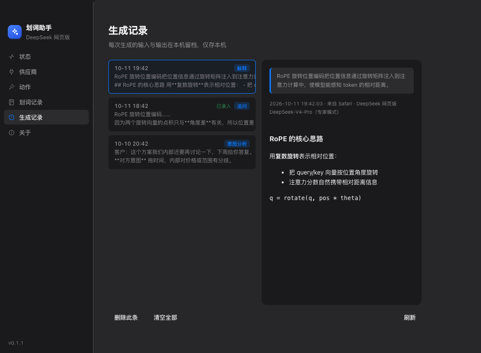

# 划词助手（HuaCi Assistant）

[](LICENSE)
[](#安装)
[](https://github.com/youniszhang/huaci-assistant/releases)

> 系统级「豆包式」划词助手：在**任何应用**里选中文字 → 按快捷键唤起工具条 → AI 流式解释 → 一键录入 Obsidian 笔记。
>
> **开源免费**（MIT）· macOS 与 Windows 双平台 · 供应商配置本机独立，也支持免 Key 的 DeepSeek 网页版

```
选中文字 ──▶ ⌘5/Ctrl+5 唤起工具条 ✨解释 🌐翻译 📝总结 ──▶ 结果卡片（流式/追问） ──▶ 📥 录入笔记
```

### 效果截图

划词后浮出的工具条（截图右上角为手动关闭 ✕）：


流式解释卡片（思考过程可折叠、底部可直接追问、一键录入笔记）：


主窗口（状态 / 供应商 / 动作 / 划词记录 / 生成记录 / 关于）：

| 状态 | 供应商 |
|---|---|
|  |  |
|  |  |

生成记录页（左侧每次生成的留档，右侧 Markdown 渲染的完整内容与元信息）：



> 截图为 UI 示意（示例数据），实际内容取决于你的配置。

---

## 与 obsidian-ai-explainer 插件的关系

| | obsidian-ai-explainer（插件） | 划词助手（本工具） |
|---|---|---|
| 作用范围 | 仅 Obsidian 内部 | **macOS 全系统**（浏览器/PDF/微信/终端…） |
| 配置来源 | 自己维护 `.obsidian/plugins/ai-explainer/data.json` | **本机独立配置**（首次运行从插件导入一次作为起点） |
| 供应商 | 三方中转 / 官方 API / DeepSeek 网页版 | 完全相同（含免 Key 的网页版） |
| 结果落地 | 原地插入批注 | 写入独立收集目录 |

> **两边配置互不影响**：本工具的供应商存在本机 `<userData>/providers.json`，在桌面端增删改
> 不会改动 Obsidian 插件配置，反之亦然。首次运行时会把插件里已有的供应商导入一份作为起点
> （只读，不改插件），省得重填；之后可以各自独立管理。
>
> 网页版（DeepSeek）也完全独立：使用自己的浏览器 profile（`<userData>/dsweb-profile`）与端口
> **9224**（插件用 9223），因此**需要单独登录一次**，之后与插件互不干扰，两边可同时使用。

---

## 功能

- **划词即用**：选中文字（拖拽 / 双击 / `Cmd+A` / `Shift+方向键`）后按 **`⌘5`** 唤起工具条（不抢焦点，原应用照常操作）。快捷键可在设置页点击后直接按新组合键修改；也可打开「划词后自动弹出工具条」回到选中即弹
- **工具条跟随选区**：工具条浮出的前提是存在选中文本——点击别处、切换应用、取消选择后自动收起；结果卡片是主动点开的工作面板，阅读/追问/录入期间保持打开，点 ✕ 才收起
- **工具条与卡片可拖动**：按住工具条任意空白处（卡片按住标题栏）拖到屏幕任意位置；拖动后位置固定，重新划词才回到选区旁。不用 `-webkit-app-region`（透明窗口上不稳定且会吞掉按钮点击），全部走 JS 实现
- **五种动作**：解释 / 翻译 / 总结 / **意图分析** / **拟回复**，提示词可随意改，也能新增自定义动作
- **框选分析（聊天/图片/PDF）**：按下 `Cmd+Shift+S` 拖拽框选任意屏幕区域 → 本地 OCR 识别文字 → 分析。**微信、钉钉等不暴露系统接口的聊天工具也能用**
- **流式输出 + 思考过程**：推理型模型的 `reasoning_content` 折叠展示，正文边生成边渲染；GFM 表格、代码块、公式正常渲染
- **结论置顶**：回答第一行就是**一句话结论**（浅底色块 + 左侧色条突出），细节在下方展开，关键词/术语**加粗**便于扫读
- **追问**：结果卡片底部可直接追问，多轮对话保持上下文
- **一键录入笔记**：写入 `<vault>/04-日常记录/AI划词解释/YYYY-MM-DD.md`，格式与插件 callout 一致；同一段文字重复解释会**覆盖同条目**而不是堆重复
- **生成记录**：每次生成（含追问与失败）的输入输出都落盘本机（`userData/history/`），主窗口「生成记录」页可回看完整正文、删除或清空；已录入笔记的条目带「已录入」标记
- **多供应商**：三方 OpenAI 兼容 API（aitry / 智谱 / DeepSeek 官方…）+ DeepSeek 网页版（**免 API Key**，用独立浏览器登录态）
- **跨平台**：macOS（Swift 原生层）与 Windows（C#/.NET 原生层）功能对等 —— 划词捕获、框选 OCR、悬浮工具条全都有
- **右键复制**：卡片里选中文字右键即可复制（复制 / 复制全部 / 全选）
- **托盘常驻，不打扰**：启动不弹主窗口，后台通过菜单栏图标操作（开/关划词监听、立即取词、框选分析、打开收集目录、打开主窗口）；仅「辅助功能」未授权时静默弹一次引导页

### 为什么需要「框选分析」

微信这类应用用自研 UI 框架绘制界面，**不通过 macOS 的无障碍接口暴露消息内容**（实测：整棵 AX 树只有登录页文字）。所以读取聊天记录采用：

```
框选屏幕区域 → macOS Vision 本地 OCR（中文准确率实测可用，~300ms） → 发给 LLM 分析
```

OCR 在本地完成，**截图不上传**，只有识别出的文字会发给你的 LLM 供应商。
提示词里已注明"OCR 可能有识别误差，请结合上下文推断"，因此个别错字不影响分析质量。

---

## 安装

### macOS

1. 下载 `HuaCiAssistant-<版本>-arm64.dmg`（[Releases](https://github.com/youniszhang/huaci-assistant/releases)）
2. 双击 DMG，把「划词助手」拖进「应用程序」
3. **首次打开**若被 Gatekeeper 拦截：右键 .app → 打开，或到 `系统设置 › 隐私与安全性` 点「仍要打开」
4. 首次运行按引导授予 **辅助功能** 与 **输入监控**；需要框选分析再额外授予 **屏幕录制**

从源码构建：

```bash
npm install --registry=https://registry.npmmirror.com --electron-mirror=https://npmmirror.com/mirrors/electron/
bash scripts/build-macos.sh            # 编译 Swift helper + esbuild + 打包 DMG
bash scripts/build-macos.sh --no-dmg   # 只构建，不打 DMG
npm start                              # 开发运行
```

### Windows

1. 下载 `HuaCiAssistant-Setup-<版本>.exe`（[Releases](https://github.com/youniszhang/huaci-assistant/releases)）
2. 双击安装（可选安装目录，自动创建桌面/开始菜单快捷方式）
3. 首次运行无需额外授权（UIA 与鼠标钩子在 Windows 上开箱可用）

从源码构建（需 [.NET 8 SDK](https://dotnet.microsoft.com/download)）：

```bash
npm install
bash scripts/build-helper-win.sh       # 编译 C# helper → bin/SelectionHelper.exe
bash scripts/build-windows.sh          # 完整构建 + 打包 NSIS 安装包
bash scripts/build-windows.sh --no-pack  # 只构建
```

> 在 macOS 上也能交叉编译出 Windows exe（`dotnet publish -r win-x64`），
> 但**无法在 macOS 上运行验证** —— Windows 功能验证请在 Windows 机器上进行。

---

## 权限说明

### macOS

| 权限 | 用途 | 不授予的后果 |
|---|---|---|
| **辅助功能**（必需） | 读取选中文字（AX API） | 划词完全失效 |
| **输入监控**（强烈建议） | 全局鼠标/键盘事件监听，用于识别「划词动作」并触发 Cmd+C 兜底 | **Electron/Chromium 类应用（Obsidian、VS Code、Chrome）完全无法取词**；原生应用仍可用，但延迟约 0.4s |
| **屏幕录制**（框选分析必需） | 截取屏幕区域做 OCR | 框选分析不可用；纯划词功能不受影响 |

> 授予路径：`系统设置 › 隐私与安全性` 下的「辅助功能」「输入监控」「屏幕录制」三处，都勾选「划词助手」。
> **权限授予后需重启 app 才生效。** 状态页会实时显示三项权限的授权情况，未授权时点「设置」可直接跳转。
>
> 为什么 Electron 类应用必须靠「输入监控」：Chromium 系应用不通过系统 AX 接口暴露选区，
> 只能在你完成划词动作后模拟一次 `Cmd+C` 把文字取出来（读完立即还原剪贴板）。
> 识别"什么时候发生了划词"依赖全局鼠标事件监听，这正是「输入监控」权限提供的。

### Windows

**无需额外授权**。划词捕获基于 UI Automation + 低级鼠标/键盘钩子，普通桌面应用开箱可用。

| 能力 | 实现 | 限制 |
|---|---|---|
| 读取选中文本 | UI Automation TextPattern | Chromium 系应用（Chrome/Obsidian/VS Code）需 Ctrl+C 兜底（读后还原剪贴板） |
| 划词动作检测 | WH_MOUSE_LL / WH_KEYBOARD_LL 钩子 | 需要应用有普通用户权限（以管理员运行的应用可能收不到事件） |
| 框选 OCR | Windows.Media.Ocr | 需要 Windows 10 2004（build 19041）以上；受保护内容（DRM）截不到 |
| 终端类应用 | 不参与 Ctrl+C 兜底 | Windows Terminal / cmd / PowerShell 里划词不触发（Ctrl+C 是中断信号） |

---

## 使用

### 划词

1. 在任意应用里选中文字（拖拽 / 双击 / `Cmd+A` / `Shift+方向键`）
2. 按 `⌘5`（默认取词快捷键）→ 工具条在选区旁浮出 → 点「解释 / 翻译 / 总结」
3. 卡片流式显示答案；底部可「录入笔记」「复制」「重试」，输入框可继续追问
4. 工具条跟随选区：点别处 / 切换应用自动收起；点「解释」等动作后卡片打开，卡片不随点击别处消失，点 ✕ 主动收起
5. 工具条和卡片都能拖动：按住工具条空白处拖动整个工具条；卡片按住顶部标题栏拖动（✕ / 停止等按钮不受影响）

> **想回到「选中即弹」**：设置页勾选「划词后自动弹出工具条」即可（默认关闭，
> 因为拖拽选字时频繁弹出会打扰）。

### 生成记录

主窗口侧栏「生成记录」页：

- 每次生成完成后自动留档（选区原文、追问问题、正文、思考过程、来源应用、供应商/模型）
- 失败与中途停止也留档（含已生成的部分内容与错误信息），便于排查
- 右侧详情用 Markdown 渲染（表格、代码块、公式与悬浮卡片一致）
- 「删除此条」「清空全部」管理本机记录；已录入笔记的条目显示「已录入」标记
- 存储位置：`~/Library/Application Support/划词助手/history/`，一条一个 JSON，超过 1000 条自动清理最旧的

### 框选分析（聊天记录 / 图片 / PDF）

1. 按 `Cmd+Shift+S`（或点托盘菜单「框选屏幕区域分析」，或状态页「框选分析」按钮）
2. 屏幕变暗 → **拖拽框选**要分析的区域（聊天消息、图片里的文字、PDF 内容都行）
3. 松手后自动 OCR，识别完弹出工具条（选区位置显示识别到的文字）
4. 点「意图分析」拆解对方目的与决策依据，或点「拟回复」生成回复草稿

> 视觉上：分析卡片会**紧贴选区下方**浮出，看起来就像挂在聊天气泡下面（无法真正插入微信界面，
> 因为那需要修改微信进程；覆盖层是唯一合规稳定的方式）。

### 快捷键

| 快捷键 | 作用 |
|---|---|
| `⌘5` | 取词：选中文字后唤起工具条（默认，可在设置里改/清空） |
| `⌘⇧S` | 框选屏幕区域分析（默认，可在设置里改/清空） |
| `Cmd+S` | 卡片内：录入笔记 |
| `Esc` | 关闭卡片（追问输入框聚焦时生效；工具条态用 ✕ 关闭） |

### 笔记格式

写入 `04-日常记录/AI划词解释/2026-10-07.md`（按日期每天一个文件，追加）：

```markdown
---
type: ai-capture
created: 2026-10-07
---

# AI 划词记录 2026-10-07

<!-- aif3hkqz -->
> [!note]- ✨ 解释：未来关于IT行业从业人员来说，掌握基础的知识只是该行
> 这段话像承上启下的结论：IT 行业门槛变了——基础知识只让你"能进场"…
>
> **术语**：
> - **IT 行业**：做软件、系统、网络等技术工作的领域。
> <sub>来源：Obsidian · DeepSeek 网页版 DeepSeek-V4-Pro（专家模式）</sub>
```

> 同一段选区再次解释 → 通过 `djb2` 哈希（与插件同算法）定位并覆盖同一条目。
> `PreviousArticle` / `NextArticle` 由你的 series-nav 插件自动注入，本工具不写。

---

## 配置

### 供应商（本机独立配置）

配置来源：本机 `<userData>/providers.json`（即
`~/Library/Application Support/划词助手/providers.json`）。
**与 Obsidian 插件配置完全独立**，增删改只影响本机这份。

> **首次运行**会把 Obsidian 插件里已有的供应商导入一份作为起点（只读插件配置，
> 不改动它），所以通常无需重新填写；之后两边各管各的。
> 没有 Obsidian 也能用——直接点「新增供应商」即可。
>
> 新增支持两种类型：**API 中转站**（OpenAI 兼容：地址 + Key + 模型名）与
> **DeepSeek 网页版**（免 Key，用桌面端自己的浏览器登录态；地址/模型可留空用默认值）。
> 若列表里没有网页版，会显示一个「一键添加」提示条；点「登录网页版」时也会自动补建。

- 在「供应商」页可点选强制指定某个供应商；「跟随插件当前设置」则用插件里 active 的那个
- 「测试」按钮可探测连通性（API 显示延迟，网页版显示登录状态）
- 「编辑」可改名称 / 地址 / Key / 模型（网页版还可改端口与专家模式开关）；
  「删除」移除条目，删掉的若是当前使用中的，会自动切到其它可用项
- **DeepSeek 网页版**：使用**桌面端自己的专用浏览器**（profile 在
  `~/Library/Application Support/划词助手/dsweb-profile`，端口 **9224**），
  与 Obsidian 插件的登录态互不影响，两边可同时使用。
  首次点「登录网页版」会**在专用浏览器窗口内**打开登录页（不是系统默认浏览器——
  登录态必须写进专用 profile 才算数），登录完成后助手会自动探测并提示成功。
  旁边「检查登录状态」可随时确认；「关闭浏览器」会关掉专用窗口（下次自动以 headless 重启）。

  > **新电脑首次登录**：点「登录网页版」时若后台已跑着 headless（不可见）实例
  > （例如刚点过「解释」触发过一次生成），助手会先把它关掉、再以**可见窗口**重启，
  > 确保你能看到并操作登录页。登录期间的登录态轮询只读探测、不会打断你正在填写的页面。

### 动作与提示词

「动作与提示词」页可改按钮文案、图标、提示词模板。模板变量：

| 变量 | 含义 |
|---|---|
| `{{selection}}` | 选中的文字 |
| `{{targetLang}}` | 翻译目标语言（默认「简体中文」） |
| `{{app}}` | 来源应用名 |

### 其他设置

| 项 | 说明 |
|---|---|
| 划词后自动弹出工具条 | **默认关闭**：选中文字后按取词快捷键（或托盘/状态页「立即取词」）唤起。开启则选中即弹 |
| DeepSeek 网页版后台运行 | 开启则不弹浏览器窗口（headless） |
| 取词快捷键 | **点按钮后直接按组合键**即可（无需手写格式）；`×` 清除；与其它软件冲突时按钮标红并提示 |
| 划词长度上限 | 默认 3000 字，超出会截断并提示 |

---

## 架构

```
┌─ 原生划词助手（平台各自实现，协议完全一致）─────────────────┐
│  macOS:   swift/SelectionHelper.swift  → bin/SelectionHelper│
│           · 事件通道：CGEventTap 鼠标 + NSEvent 键盘        │
│           · 轮询通道：Accessibility API 读选区              │
│           · 框选 OCR：ScreenCaptureKit + Vision             │
│  Windows: win/SelectionHelper/*.cs     → bin/SelectionHelper.exe
│           · 事件通道：WH_MOUSE_LL / WH_KEYBOARD_LL 钩子     │
│           · 轮询通道：UI Automation TextPattern 读选区      │
│           · 框选 OCR：GDI 截屏 + Windows.Media.Ocr          │
│  两者共用同一套 JSON-lines over stdio 协议                  │
└────────────────────────┬──────────────────────────────────┘
                         │ spawn + stdin/stdout（主进程无需区分平台）
┌────────────────────────▼──────────────────────────────────┐
│                  Electron 主进程 (TypeScript)             │
│  capture.ts    进程管理 / 协议解析 / 崩溃重启              │
│  obsidian.ts   发现 vault、读插件 data.json、供应商解析     │
│  note.ts       写笔记（callout 格式 + 哈希覆盖）            │
│  history.ts    生成记录落盘（userData/history/，一条一 JSON）│
│  overlay.ts    悬浮窗（不抢焦点、按需临时聚焦、JS 拖动）     │
│  llm/api.ts    OpenAI 兼容三通道（Node流→fetch流→非流式）   │
│  llm/dsweb.ts  DeepSeek 网页版 CDP 自动化（移植自插件）      │
├───────────────────────────────────────────────────────────┤
│  renderer/overlay.html  工具条 + 结果卡片（流式渲染）       │
│  renderer/md.js         GFM Markdown 渲染（两窗口共用）     │
│  renderer/main.html     状态 / 供应商 / 提示词 / 记录       │
└───────────────────────────────────────────────────────────┘
```

### 目录结构

```
划词助手/
├── package.json / tsconfig.json / esbuild.config.mjs
├── src/
│   ├── main/
│   │   ├── main.ts       入口：托盘、窗口、IPC、划词编排
│   │   ├── capture.ts    Swift helper 子进程管理
│   │   ├── overlay.ts    悬浮窗窗口
│   │   ├── obsidian.ts   配置桥（读插件 data.json）
│   │   ├── note.ts       笔记写入
│   │   ├── history.ts    生成记录落盘
│   │   ├── settings.ts   本工具自身设置
│   │   └── llm/          cdp.ts / dsweb.ts / api.ts / index.ts / types.ts
│   ├── preload/preload.js
│   ├── renderer/         overlay.* / main.* / md.js / mock-bridge.js
│   │   └── assets/       图标与赞助收款码
│   └── shared/api.js     IPC 通道常量
├── swift/                  macOS 原生层（Swift）
│   ├── SelectionHelper.swift  划词捕获主程序（833 行）
│   ├── ScreenOCR.swift        区域截屏 + Vision OCR
│   └── build.sh               编译脚本
├── win/                    Windows 原生层（C#/.NET 8）
│   └── SelectionHelper/
│       ├── Program.cs         划词捕获主程序（UIA + 钩子）
│       ├── ScreenOcr.cs       区域截屏 + Windows.Media.Ocr
│       └── SelectionHelper.csproj
├── scripts/
│   ├── build-macos.sh    一键构建 + 打包 DMG
│   ├── make-icons.sh     生成 icns 与托盘图标
│   ├── test-api.js       测 API 通道（读真实配置）
│   ├── test-note.js      测笔记写入格式与覆盖
│   ├── inspect-overlay.js 用 CDP 调试悬浮窗
│   └── e2e/              E2E 回归（mock helper + CDP 驱动，见下）
└── bin/SelectionHelper   编译产物
```

---

## 常见问题

**划词没反应？**
1. 到「状态」页确认「划词监听」为「运行中」、「辅助功能权限」为「已授权」
2. 未授权时点「打开系统设置」勾选「划词助手」，然后重启 app
3. 终端类应用（Terminal / iTerm）出于安全不使用 Cmd+C 兜底，若 AX 也读不到则不响应

**划词有延迟？**
没给「输入监控」权限时会走轮询检测（约 0.4s）。到 `系统设置 › 隐私与安全性 › 输入监控` 里勾选可显著加快。

**点「解释」没反应 / 报错未找到供应商？**
确认 Obsidian 里 `ai-explainer` 插件已装好且有启用的供应商；到「供应商」页点「测试」看具体错误。

**DeepSeek 网页版提示未登录？**
到「供应商」页点「登录网页版」——会在**专用浏览器窗口**（独立 profile）里打开登录页，完成登录后助手自动提示成功；
也可点「检查登录状态」确认。若此前在 Obsidian 插件里登录过则共用登录态，无需重复登录。

**打包后首次打开被拦？**
未签名应用，右键 .app → 打开；或 `系统设置 › 隐私与安全性` → 「仍要打开」。

**重新编译后权限失效？**
未签名 app 每次重建签名都变，需到辅助功能里取消再重新勾选。

---

## 已知限制

**通用**

- Electron / Chromium 系应用（Obsidian、VS Code、Chrome）不通过系统无障碍接口暴露选区，
  这些应用里「拖拽选取」依赖 Ctrl/Cmd+C 兜底（读后自动还原剪贴板）；终端类应用不参与兜底
- DeepSeek 网页版通道易受官网改版影响（选择器可能失效，需要跟随更新）
- 供应商配置存本机（`<userData>/providers.json`），换机器需重新配置

**macOS**

- 依赖 Accessibility API / CGEventTap / Vision；未做代码签名与公证，
  分发需手动绕过 Gatekeeper（右键 .app → 打开）
- 每次重新打包后主程序签名会变，需到「辅助功能」里重新授权

**Windows**

- 需要 Windows 10 2004（build 19041）以上 —— `Windows.Media.Ocr` 的最低要求
- 以管理员权限运行的应用可能收不到低级钩子事件（Windows 的 UIPI 限制）
- Windows OCR 不提供逐行置信度，因此「识别质量提示」功能在 Windows 上不可用
- Windows 原生层（`win/`）尚未在真机做过完整验证 —— 欢迎试用后反馈

---

## 开发

```bash
npm run dev                              # esbuild watch（改渲染层/主进程时用）
npx tsc --noEmit --skipLibCheck          # 类型检查

# 原生层（按平台）
bash swift/build.sh                      # macOS：重编 Swift helper
bash scripts/build-helper-win.sh         # Windows：重编 C# helper（需 .NET 8 SDK）

# 单项测试
node scripts/test-api.js                 # 直接测 API 通道
node scripts/test-note.js                # 测笔记写入与覆盖
node scripts/inspect-overlay.js          # 调试悬浮窗（需 --remote-debugging-port=9222 启动）
```

> 原生层的协议是**两个平台共用的契约**：改协议要同步改 `swift/SelectionHelper.swift`
> 与 `win/SelectionHelper/Program.cs`，并确认 `src/main/capture.ts` 的解析不变。

### E2E 回归

`scripts/e2e/run-e2e.sh` 用 mock SelectionHelper（JSON-lines 协议）+ 渲染层 CDP + 主进程 inspector
驱动真实交互，覆盖工具条状态机（选中浮出 / 点击别处收起 / 双击选词 / OCR 卡片生命周期）与
v0.1.1 功能（拖动 IPC、生成记录页端到端、autoPopup 拦截与手动放行）：

```bash
bash scripts/e2e/run-e2e.sh              # 全部用例
bash scripts/e2e/run-e2e.sh lifecycle    # 只跑工具条状态机
bash scripts/e2e/run-e2e.sh v011         # 只跑拖动/历史/autoPopup
bash scripts/e2e/run-e2e.sh dsweb-login  # 网页版登录链路（真机，隔离 profile）
bash scripts/e2e/run-e2e.sh dsweb-provider  # 供应商条目补建（纯文件，含边界）
bash scripts/e2e/run-e2e.sh provider-crud   # 供应商增删改（纯文件，含边界）
bash scripts/e2e/run-e2e.sh hotkey-lead     # 快捷键录制 + 结论置顶渲染
bash scripts/e2e/run-e2e.sh provider-independence  # 供应商配置独立（含互不影响断言）
```

> helper 在跑测试前被替换为 mock、结束后**字节级还原**（CDHash 不变 → 已授予的 TCC 权限无损）。
> 脚本退出时会清理 mock helper 残留进程——它们由 electron spawn，杀 electron 会变孤儿，
> 抢读控制文件会让下一轮出现难以定位的假失败。
>
> `dsweb-login` 用例启动真实的专用浏览器（独立端口 9225 + 独立 profile），
> 验证「headless 实例存在时登录页仍能以可见窗口打开」与「登录轮询探测不导航」，
> 跑完自动清理，不影响真实登录态。

## 贡献

欢迎 issue 与 PR！这个项目完全由业余时间维护，任何形式的帮助都有价值。

### 报告问题

提 issue 时请附上：

- 系统版本（macOS 14.x / Windows 11 23H2…）与 App 版本（设置页「关于」可见）
- **日志**：macOS 在 `~/Library/Application Support/划词助手/logs/main.log`；
  Windows 在 `%APPDATA%\划词助手\logs\main.log`
- 复现步骤与期望行为

### 参与开发

1. Fork → 建分支 → 改 → 提 PR
2. 提交前请跑：
   ```bash
   npx tsc --noEmit --skipLibCheck
   bash scripts/e2e/run-e2e.sh          # macOS：E2E 回归（136 项）
   ```
3. 改原生层时请说明验证方式（macOS 上无法验证 Windows helper 的实际行为）

### 代码约定

- 注释写「为什么」，不写「是什么」—— 尤其是踩过的坑（本项目多处注释记录了
  实测结论，例如「为什么不能用 -webkit-app-region」「为什么悬浮窗要自绘右键菜单」）
- 改行为要同步更新 README 与 E2E
- 新增 E2E 用例放 `scripts/e2e/`，并在 `run-e2e.sh` 里注册

### 适合上手的任务

- 补充 Windows 端的 E2E（当前 E2E 基于 macOS 的 CDP + mock helper 架构）
- DeepSeek 网页版选择器的健壮性（官网改版会导致失效）
- 更多语言的 OCR 支持

---

## 支持这个项目

如果它帮到了你，可以[请作者喝杯咖啡](https://github.com/youniszhang/huaci-assistant#支持这个项目) ☕️
（App 内「关于」页也有收款码）

## 致谢

- 灵感来自 [obsidian-ai-explainer](https://github.com/youniszhang/obsidian-ai-explainer) 插件
- 划词捕获方案参考了豆包的交互设计

## 许可证

MIT —— 详见 [LICENSE](LICENSE)
